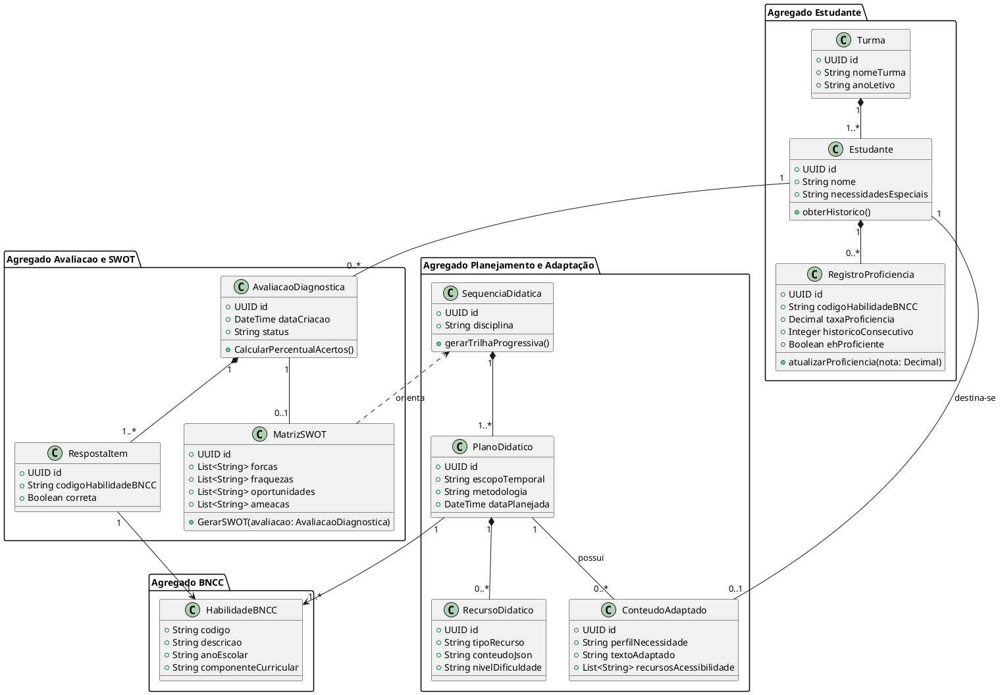

# EduPlanner - Documentação Técnica de Análise e Especificação (Etapas 01 e 02)

## 1. Visão Geral do Sistema
**EduPlanner** é um assistente SaaS para planejamento didático multidisciplinar e avaliação pedagógica contínua, estritamente baseado nas habilidades e competências da BNCC (Base Nacional Comum Curricular).

### Perfis e Público-Alvo
- **Educadores/Professores:** Criação de diagnósticos, planos de aula adaptados e recursos didáticos.
- **Estudantes:** Realização de avaliações diagnósticas e periódicas.
- **Coordenadores Pedagógicos:** Acompanhamento analítico do desempenho por turma/escola.

---

## 2. Premissas Técnicas e Arquiteturais
1. **Domínio Vinculado à BNCC:** Qualquer entidade pedagógica possui como invariante de domínio a referência a pelo menos um código da BNCC.
2. **Arquitetura Limpa (Clean Architecture / DDD):** Separação estrita entre Apresentação, Aplicação, Domínio e Infraestrutura.
3. **Privacidade e LGPD:** Mascaramento e anonimização de PII antes do envio para provedores externos de IA.

---

## 3. Requisitos Funcionais (RF)

| ID_RF | Nome | Descrição | Prioridade | Restrição | Justificativa | Critérios de Aceitação |
| :--- | :--- | :--- | :--- | :--- | :--- | :--- |
| **RF01** | Avaliação Diagnóstica BNCC (`/iniciar_avaliacao`) | Aplicar e registrar avaliações diagnósticas estruturadas com base nos códigos de habilidades da BNCC por aluno ou turma. | Alta | Exige cadastro prévio da matriz BNCC. | Identificação de lacunas de aprendizado. | Registrar taxa de acerto por código BNCC. |
| **RF02** | Análise SWOT Pedagógica (`/gerar_SWOT`) | Gerar a matriz SWOT pedagógica (Forças, Fraquezas, Oportunidades, Ameaças) a partir dos resultados do diagnóstico. | Alta | Disparado somente após o término do diagnóstico (min 80%). | Visão executiva e analítica da situação do aluno. | Classificar habilidades de forma determinística nas 4 dimensões. |
| **RF03** | Sequenciamento Didático Multidisciplinar (`/criar_sequencia`) | Elaborar sequência adaptativa de conteúdos em várias disciplinas orientada a sanar os pontos fracos da SWOT. | Alta | Respeitar dependências prévias da BNCC. | Garantir continuidade pedagógica. | Exibir encadeamento lógico e códigos BNCC correlatos. |
| **RF04** | Motor de Adaptação de Linguagem (`/adaptar_conteudo`) | Reescrever e adaptar conteúdos com base em parâmetros de linguagem e necessidades específicas (ex: TDAH, Autismo). | Média | Não alterar o objetivo pedagógico central da BNCC. | Promover inclusão e personalização. | Manter equivalência pedagógica alterando tom/suporte. |
| **RF05** | Gestão de Planos Didáticos Multi-nível (`/planejar_aula`) | Gerar e gerenciar planos de aula diários, semanais, mensais e anuais. | Alta | Todos os planos devem ter objetivos BNCC. | Estruturar fluxo de trabalho do educador. | Permitir visualizar e exportar planos completos. |
| **RF06** | Gerador de Recursos e Slides (`/criar_recursos`) | Gerar roteiros de slides e atividades objetivas/discursivas vinculadas ao plano de aula. | Média | Atividades devem conter gabarito e critérios de correção. | Reduzir tempo de preparação de aulas. | Slides estruturados e atividades com níveis de dificuldade. |
| **RF07** | Monitoramento de Progresso Periódico - Kumon (`/avaliar_progresso`) | Aplicar testes curtos periódicos para verificar retenção e proficiência contínua. | Alta | Requer histórico prévio de planos aplicados. | Validar domínio antes da progressão. | Atingir nota >= 85% em 2 testes consecutivos para validar proficiência. |
| **RF08** | Painel Analítico de Desempenho | Gerar gráficos analíticos (evolução temporal e teia de competências) e relatórios após avaliações. | Alta | Acesso restrito a perfis autorizados. | Tomada de decisão baseada em dados. | Exibir gráficos atualizados em tempo real. |

---

## 4. Requisitos Não Funcionais (RNF)

| ID_RNF | Categoria | Descrição | Critério de Verificação |
| :--- | :--- | :--- | :--- |
| **RNF01** | **Privacidade e LGPD** | Criptografar dados sensíveis de estudantes e anonimizar payloads para LLMs. | Auditoria de segurança e logs sem PII. |
| **RNF02** | **Desempenho** | Geração de planos e adaptações via IA em até 3,5s (P95) via streaming. | Testes de carga automatizados (k6). |
| **RNF03** | **Disponibilidade** | SLA mínimo de 99,5% em ambiente Cloud. | APM e relatórios de uptime. |
| **RNF04** | **Acessibilidade** | Conformidade com WCAG 2.1 nível AA. | Validação via Axe e Lighthouse. |
| **RNF05** | **Segurança** | Autenticação OAuth2/OIDC, RBAC e proteção OWASP Top 10. | Testes SAST/DAST. |
| **RNF06** | **Testabilidade** | Cobertura mínima de testes unitários/integração de 80%. | Relatório de cobertura em CI/CD. |

---

## 5. Regras de Negócio (RN)
* **RN01 - Rastreabilidade BNCC Obrigatória:** Nenhuma entidade pedagógica pode ser gravada sem a vinculação de pelo menos um código da BNCC.
* **RN02 - Disparo de Análise SWOT:** A matriz SWOT só é liberada se a avaliação diagnóstica tiver pelo menos 80% dos itens respondidos.
* **RN03 - Limiar de Proficiência Kumon:** A proficiência é concedida após desempenho >= 85% em 2 avaliações periódicas consecutivas.
* **RN04 - Precedência de Pré-Requisitos:** Ameaças (pré-requisitos defasados) devem anteceder conteúdos novos do ano corrente na sequência didática.
* **RN05 - Inviolabilidade da Acessibilidade:** A adaptação de linguagem não pode anular nem simplificar excessivamente o objetivo da habilidade BNCC.
* **RN06 - Obrigatoriedade de Avaliação Vinculada:** Todo plano didático deve incluir pelo menos uma estratégia ou instrumento de avaliação definido.

---

## 6. Matriz de Rastreabilidade (RF -> UC)

| ID_RF | Requisito Funcional | ID_UC | Caso de Uso Correspondente | Tipo de Mapeamento |
| :--- | :--- | :--- | :--- | :--- |
| **RF01** | Avaliação Diagnóstica BNCC | **UC01** | Realizar Avaliação Diagnóstica BNCC | 1:1 |
| **RF02** | Análise SWOT Pedagógica | **UC02** | Gerar Matriz SWOT Pedagógica | 1:1 |
| **RF03** | Sequenciamento Didático Multidisciplinar | **UC03** | Elaborar Sequência Didática Adaptativa | 1:1 |
| **RF04** | Motor de Adaptação de Linguagem | **UC04** | Adaptar Linguagem e Acessibilidade do Conteúdo | 1:1 |
| **RF05** | Gestão de Planos Didáticos Multi-nível | **UC05** | Elaborar Plano Didático (Diário, Semanal, Mensal, Anual) | 1:1 |
| **RF06** | Gerador de Recursos e Slides | **UC06** | Gerar Roteiro de Slides e Atividades Objetivas | 1:1 |
| **RF07** | Monitoramento de Progresso Periódico | **UC07** | Aplicar Avaliação Periódica e Validar Proficiência | 1:1 |
| **RF08** | Painel Analítico de Desempenho | **UC08** | Visualizar Painel Analítico de Desempenho | 1:1 |

---

## 7. Especificação Detalhada dos Casos de Uso (UC01 a UC08)

### UC01 - Realizar Avaliação Diagnóstica BNCC
- **Atores:** Educador (Principal), Estudante (Secundário).
- **Pré-condições:** Estudante/Turma cadastrados; Matriz BNCC parametrizada.
- **Fluxo Básico:** Executa `/iniciar_avaliacao` -> Recupera habilidades BNCC -> Estudante responde -> Calcula taxa por código -> Marca "Concluído".
- **Fluxos Alternativos:** FA01 (Respostas <80% -> Salva rascunho, bloqueia SWOT); FA02 (Aplicação coletiva por turma); FE01 (Sem habilidade mapeada).
- **Estrutura de Dados:** `estudanteId` (UUID), `turmaId` (UUID), `disciplina` (String), `anoEscolar` (String), `codigoHabilidadeBNCC` (String), `respostaItem` (Boolean), `taxaAcertoHabilidade` (Decimal), `statusAvaliacao` (Enum).
- **Regras de Negócio:** RN01, RN02.

### UC02 - Gerar Matriz SWOT Pedagógica
- **Atores:** Educador.
- **Pré-condições:** UC01 com status "Concluído" (>= 80% respondido).
- **Fluxo Básico:** Executa `/gerar_SWOT` -> Analisa acertos -> Mapeia Forças (>=80%), Fraquezas (<50%), Oportunidades (50-79%), Ameaças (lacunas anteriores) -> Exibe matriz.
- **Fluxos Alternativos:** FA01 (Recálculo por novo diagnóstico versionado); FA02 (SWOT consolidada por turma); FE01 (Bloqueio se <80%).
- **Estrutura de Dados:** `matrizSwotId` (UUID), `avaliacaoId` (UUID), `forcas` (List), `fraquezas` (List), `oportunidades` (List), `ameacas` (List), `dataGeracao` (DateTime).
- **Regras de Negócio:** RN01, RN02.

### UC03 - Elaborar Sequência Didática Adaptativa
- **Atores:** Educador.
- **Pré-condições:** UC02 (SWOT) disponível.
- **Fluxo Básico:** Executa `/criar_sequencia` -> Recupera SWOT -> Analisa dependências BNCC -> Ordena Ameaças/Fraquezas antes de novos conteúdos -> Apresenta plano -> Salva.
- **Fluxos Alternativos:** FA01 (Reordenação manual pelo professor); FA02 (Projeto multidisciplinar); FE01 (Ausência de SWOT ativa).
- **Estrutura de Dados:** `sequenciaId` (UUID), `estudanteOuTurmaId` (UUID), `ordemEtapa` (Integer), `codigoHabilidadeBNCC` (String), `descricaoConteudo` (Text), `cargaHorariaEstimada` (Integer).
- **Regras de Negócio:** RN01, RN04.

### UC04 - Adaptar Linguagem e Acessibilidade do Conteúdo
- **Atores:** Educador.
- **Pré-condições:** Conteúdo selecionado; perfil do estudante identificado (ex: TDAH, Autismo).
- **Fluxo Básico:** Executa `/adaptar_conteudo` -> Exibe questionário de acessibilidade -> Ajusta tom/estrutura (frases curtas, suporte visual) -> Apresenta versão lado a lado -> Aprova.
- **Fluxos Alternativos:** FA01 (Sugestão automática após baixo desempenho no Kumon); FA02 (Exportação TTS/fonte dislexia); FE01 (Alerta de descaracterização BNCC).
- **Estrutura de Dados:** `adaptacaoId` (UUID), `estudanteId` (UUID), `conteudoOriginalId` (UUID), `perfilNecessidade` (String), `textoAdaptado` (Text), `recursosAcessibilidade` (List).
- **Regras de Negócio:** RN01, RN05.

### UC05 - Elaborar Plano Didático Multi-nível
- **Atores:** Educador.
- **Pré-condições:** Habilidades BNCC selecionadas.
- **Fluxo Básico:** Executa `/planejar_aula` -> Seleciona escopo (`DIARIO`, `SEMANAL`, `MENSAL`, `ANUAL`) -> Preenche objetivos BNCC, metodologia, recursos e avaliação -> Salva.
- **Fluxos Alternativos:** FA01 (Duplicação para outra turma); FA02 (Anexo de conteúdo adaptado do UC04); FE01 (Tentativa de salvar sem BNCC).
- **Estrutura de Dados:** `planoId` (UUID), `escopoTemporal` (Enum), `turmaId` (UUID), `objetivosBNCC` (List), `metodologia` (Text), `recursosNecessarios` (Text), `dataPlanejada` (Date).
- **Regras de Negócio:** RN01, RN06.

### UC06 - Gerar Roteiro de Slides e Atividades Objetivas
- **Atores:** Educador.
- **Pré-condições:** Plano Didático (UC05) ativo.
- **Fluxo Básico:** Executa `/criar_recursos` -> Processa objetivos -> Gera roteiro de slides (títulos, pontos, notas) e banco de questões (com gabarito e níveis de dificuldade) -> Exporta.
- **Fluxos Alternativos:** FA01 (Ajuste de proporção de dificuldade); FA02 (Slides com alto contraste/acessibilidade); FE01 (Fallback para Markdown/JSON se a renderização falhar).
- **Estrutura de Dados:** `recursoId` (UUID), `planoId` (UUID), `tipoRecurso` (Enum), `conteudoJson` (JSON), `nivelDificuldade` (Enum).
- **Regras de Negócio:** RN01.

### UC07 - Aplicar Avaliação Periódica e Validar Proficiência (Estilo Kumon)
- **Atores:** Estudante (Respondente), Educador/Sistema.
- **Pré-condições:** Conteúdo do plano aplicado.
- **Fluxo Básico:** Executa `/avaliar_progresso` -> Estudante responde teste rápido -> Sistema corrige -> Se nota >= 85% em 2 testes consecutivos -> Marca "Proficiente".
- **Fluxos Alternativos:** FA01 (Nota <85% -> Zera contador consecutivo, sugere UC04); FA02 (Agendamento automático de teste de reforço em 3 dias).
- **Estrutura de Dados:** `avaliacaoPeriodicaId` (UUID), `estudanteId` (UUID), `codigoHabilidadeBNCC` (String), `notaPercentual` (Decimal), `historicoConsecutivo` (Integer), `statusProficiencia` (Enum).
- **Regras de Negócio:** RN01, RN03.

### UC08 - Visualizar Painel Analítico de Desempenho
- **Atores:** Educador, Coordenador Pedagógico.
- **Pré-condições:** Avaliações realizadas.
- **Fluxo Básico:** Acessa painel -> Sistema consolida dados -> Exibe teia BNCC, evolução temporal e indicadores de turma -> Aplica filtros.
- **Fluxos Alternativos:** FA01 (Exportação em PDF); FE01 (Aviso de ausência de dados se sem testes).
- **Estrutura de Dados:** `painelId` (UUID), `turmaOuEstudanteId` (UUID), `indiceProficienciaGeral` (Decimal), `habilidadesDominadas` (List), `habilidadesEmRisco` (List).
- **Regras de Negócio:** RN01.

---

## 8. Diagramas UML (PlantUML)

