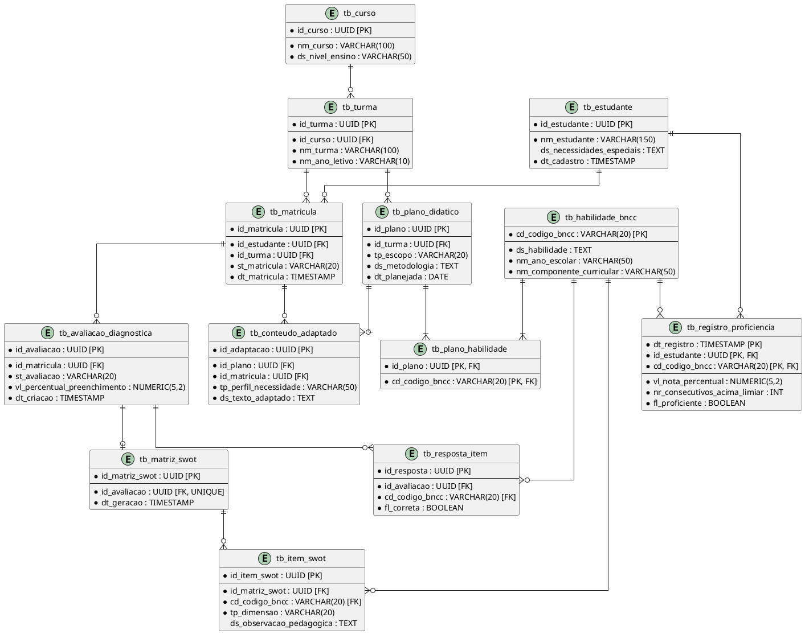

# Etapa 03 Refatorada: Arquitetura de Software e Projeto Técnico (**EduPlanner**)

---

## 1. Contrato Completo de API RESTful (OpenAPI 3.0 Specification em YAML)

```yaml
openapi: 3.0.3
info:
  title: EduPlanner SaaS API
  description: API de Gestão Pedagógica, Diagnóstico BNCC, Adaptação de Conteúdo por IA e Acompanhamento de Progresso Kumon.
  version: 1.0.0
servers:
  - url: http://localhost:8080/api/v1
    description: Ambiente Local de Desenvolvimento / Gateway Mock
  - url: http://localhost:8000/api/v1
    description: Ambiente de Produção SaaS EduPlanner

tags:
  - name: Avaliações Diagnósticas
    description: Endpoints para aplicação e consulta do diagnóstico BNCC (/iniciar_avaliacao)
  - name: Matriz SWOT
    description: Endpoints para consolidação e geração de SWOT pedagógica (/gerar_SWOT)
  - name: Adaptação de Conteúdo
    description: Endpoints para reescrita e acessibilidade via IA (/adaptar_conteudo)
  - name: Acompanhamento Kumon
    description: Endpoints para testes periódicos e proficiência (/avaliar_progresso)

paths:
  /avaliacoes/diagnostico:
    options:
      summary: Tratamento Pre-flight CORS
      responses:
        '200':
          description: OK - Permissão CORS concedida
          headers:
            Access-Control-Allow-Origin:
              schema:
                type: string
                example: "*"
            Access-Control-Allow-Methods:
              schema:
                type: string
                example: "GET, POST, OPTIONS"
            Access-Control-Allow-Headers:
              schema:
                type: string
                example: "Content-Type, Authorization"
    post:
      tags:
        - Avaliações Diagnósticas
      summary: Inicia e registra uma avaliação diagnóstica BNCC (/iniciar_avaliacao)
      operationId: iniciarAvaliacao
      requestBody:
        required: true
        content:
          application/json:
            schema:
              $ref: '#/components/schemas/IniciarAvaliacaoRequest'
      responses:
        '201':
          description: Avaliação gerada com sucesso.
          headers:
            Access-Control-Allow-Origin:
              schema:
                type: string
                example: "*"
          content:
            application/json:
              schema:
                $ref: '#/components/schemas/AvaliacaoDiagnosticaResponse'
        '400':
          $ref: '#/components/responses/400BadRequest'
        '404':
          $ref: '#/components/responses/404NotFound'
        '500':
          $ref: '#/components/responses/500InternalError'

  /swot/gerar:
    options:
      summary: Tratamento Pre-flight CORS
      responses:
        '200':
          description: OK - Permissão CORS concedida
          headers:
            Access-Control-Allow-Origin:
              schema:
                type: string
                example: "*"
            Access-Control-Allow-Methods:
              schema:
                type: string
                example: "POST, OPTIONS"
            Access-Control-Allow-Headers:
              schema:
                type: string
                example: "Content-Type, Authorization"
    post:
      tags:
        - Matriz SWOT
      summary: Gera a Matriz SWOT Pedagógica (/gerar_SWOT)
      operationId: gerarSwot
      requestBody:
        required: true
        content:
          application/json:
            schema:
              type: object
              required: [avaliacaoId]
              properties:
                avaliacaoId:
                  type: string
                  format: uuid
                  example: "a1b2c3d4-e5f6-7a8b-9c0d-1e2f3a4b5c6d"
      responses:
        '200':
          description: Matriz SWOT gerada e armazenada em 1FN.
          headers:
            Access-Control-Allow-Origin:
              schema:
                type: string
                example: "*"
          content:
            application/json:
              schema:
                $ref: '#/components/schemas/MatrizSwotResponse'
        '422':
          description: Bloqueio por RN02 (Diagnóstico com preenchimento inferior a 80%).
          content:
            application/json:
              schema:
                $ref: '#/components/schemas/ErrorResponse'

  /conteudos/adaptar:
    options:
      summary: Tratamento Pre-flight CORS
      responses:
        '200':
          description: OK - Permissão CORS concedida
          headers:
            Access-Control-Allow-Origin:
              schema:
                type: string
                example: "*"
            Access-Control-Allow-Methods:
              schema:
                type: string
                example: "POST, OPTIONS"
            Access-Control-Allow-Headers:
              schema:
                type: string
                example: "Content-Type, Authorization"
    post:
      tags:
        - Adaptação de Conteúdo
      summary: Executa adaptação de linguagem e acessibilidade (/adaptar_conteudo)
      operationId: adaptarConteudo
      requestBody:
        required: true
        content:
          application/json:
            schema:
              type: object
              required: [matriculaId, planoId, perfilNecessidade]
              properties:
                matriculaId:
                  type: string
                  format: uuid
                  example: "3fa85f64-5717-4562-b3fc-2c963f66afa6"
                planoId:
                  type: string
                  format: uuid
                  example: "b2c3d4e5-f6a7-8b9c-0d1e-2f3a4b5c6d7e"
                perfilNecessidade:
                  type: string
                  example: "TDAH"
      responses:
        '200':
          description: Conteúdo reescrito com sucesso.
          headers:
            Access-Control-Allow-Origin:
              schema:
                type: string
                example: "*"
          content:
            application/json:
              schema:
                $ref: '#/components/schemas/ConteudoAdaptadoResponse'

  /avaliacoes/progresso:
    options:
      summary: Tratamento Pre-flight CORS
      responses:
        '200':
          description: OK - Permissão CORS concedida
          headers:
            Access-Control-Allow-Origin:
              schema:
                type: string
                example: "*"
            Access-Control-Allow-Methods:
              schema:
                type: string
                example: "POST, OPTIONS"
            Access-Control-Allow-Headers:
              schema:
                type: string
                example: "Content-Type, Authorization"
    post:
      tags:
        - Acompanhamento Kumon
      summary: Processa teste periódico e valida regra Kumon (/avaliar_progresso)
      operationId: avaliarProgresso
      requestBody:
        required: true
        content:
          application/json:
            schema:
              type: object
              required: [estudanteId, codigoHabilidadeBNCC, notaPercentual]
              properties:
                estudanteId:
                  type: string
                  format: uuid
                  example: "3fa85f64-5717-4562-b3fc-2c963f66afa6"
                codigoHabilidadeBNCC:
                  type: string
                  example: "EF05MA03"
                notaPercentual:
                  type: number
                  format: float
                  example: 88.5
      responses:
        '200':
          description: Teste registrado e status de proficiência atualizado.
          headers:
            Access-Control-Allow-Origin:
              schema:
                type: string
                example: "*"
          content:
            application/json:
              schema:
                $ref: '#/components/schemas/ProgressoResponse'

components:
  responses:
    400BadRequest:
      description: Requisição inválida ou parâmetros ausentes.
      content:
        application/json:
          schema:
            $ref: '#/components/schemas/ErrorResponse'
    404NotFound:
      description: Recurso não encontrado (Matrícula, Plano ou Habilidade inexistente).
      content:
        application/json:
          schema:
            $ref: '#/components/schemas/ErrorResponse'
    500InternalError:
      description: Erro interno do servidor ou falha de orquestração de IA.
      content:
        application/json:
          schema:
            $ref: '#/components/schemas/ErrorResponse'

  schemas:
    IniciarAvaliacaoRequest:
      type: object
      required: [matriculaId, disciplina, anoEscolar]
      properties:
        matriculaId:
          type: string
          format: uuid
          example: "3fa85f64-5717-4562-b3fc-2c963f66afa6"
        disciplina:
          type: string
          example: "Matemática"
        anoEscolar:
          type: string
          example: "5º Ano EF"

    AvaliacaoDiagnosticaResponse:
      type: object
      properties:
        avaliacaoId:
          type: string
          format: uuid
          example: "a1b2c3d4-e5f6-7a8b-9c0d-1e2f3a4b5c6d"
        status:
          type: string
          example: "EM_ANDAMENTO"
        percentualPreenchimento:
          type: number
          example: 0.00
        itensBNCC:
          type: array
          items:
            type: object
            properties:
              codigoBNCC:
                type: string
                example: "EF05MA01"
              enunciado:
                type: string
                example: "Resolver problemas de adição com números naturais."

    MatrizSwotResponse:
      type: object
      properties:
        matrizId:
          type: string
          format: uuid
          example: "f1e2d3c4-b5a6-7890-1234-56789abcdef0"
        avaliacaoId:
          type: string
          format: uuid
          example: "a1b2c3d4-e5f6-7a8b-9c0d-1e2f3a4b5c6d"
        itensSwot:
          type: array
          items:
            type: object
            properties:
              dimensao:
                type: string
                example: "FORCA"
              codigoBNCC:
                type: string
                example: "EF05MA01"
              observacao:
                type: string
                example: "Excelente retenção na resolução de problemas de adição."

    ConteudoAdaptadoResponse:
      type: object
      properties:
        adaptacaoId:
          type: string
          format: uuid
          example: "98765432-10fe-dcba-9876-543210fedcba"
        textoAdaptado:
          type: string
          example: "Conteúdo reescrito com frases curtas e destacadores visuais para suporte a TDAH."
        recursosAplicados:
          type: array
          items:
            type: string
            example: "FRASES_CURTAS"

    ProgressoResponse:
      type: object
      properties:
        estudanteId:
          type: string
          format: uuid
        codigoHabilidadeBNCC:
          type: string
          example: "EF05MA03"
        notaPercentual:
          type: number
          example: 88.5
        consecutivosAcimaLimiar:
          type: integer
          example: 2
        ehProficiente:
          type: boolean
          example: true

    ErrorResponse:
      type: object
      properties:
        codigo:
          type: string
          example: "ERR_RN02_INCOMPLETO"
        mensagem:
          type: string
          example: "A avaliação diagnóstica deve possuir no mínimo 80% de preenchimento para gerar a SWOT."
        timestamp:
          type: string
          format: date-time
```

---

## 2. Modelo Entidade-Relacionamento (MER) - Conceitual Refatorado

### Entidades, Atributos e Chaves:
1. **CURSO** (`tb_curso`):
   - `id_curso` (PK, UUID, Não Nulo)
   - `nm_curso` (String(100), Não Nulo)
   - `ds_nivel_ensino` (String(50), Não Nulo)

2. **TURMA** (`tb_turma`):
   - `id_turma` (PK, UUID, Não Nulo)
   - `id_curso` (FK -> `tb_curso`, UUID, Não Nulo)
   - `nm_turma` (String(100), Não Nulo)
   - `nm_ano_letivo` (String(10), Não Nulo)

3. **ESTUDANTE** (`tb_estudante`):
   - `id_estudante` (PK, UUID, Não Nulo)
   - `nm_estudante` (String(150), Não Nulo)
   - `ds_necessidades_especiais` (Text, Opcional)
   - `dt_cadastro` (Timestamp, Não Nulo)

4. **MATRICULA** (`tb_matricula`): *(Tabela Associativa para 3FN)*
   - `id_matricula` (PK, UUID, Não Nulo)
   - `id_estudante` (FK -> `tb_estudante`, UUID, Não Nulo)
   - `id_turma` (FK -> `tb_turma`, UUID, Não Nulo)
   - `st_matricula` (Enum: 'ATIVA', 'INATIVA', 'TRANSFERIDO', 'CONCLUIDO', Não Nulo)
   - `dt_matricula` (Timestamp, Não Nulo)

5. **HABILIDADE_BNCC** (`tb_habilidade_bncc`):
   - `cd_codigo_bncc` (PK, String(20), Não Nulo)
   - `ds_habilidade` (Text, Não Nulo)
   - `nm_ano_escolar` (String(50), Não Nulo)
   - `nm_componente_curricular` (String(50), Não Nulo)

6. **AVALIACAO_DIAGNOSTICA** (`tb_avaliacao_diagnostica`):
   - `id_avaliacao` (PK, UUID, Não Nulo)
   - `id_matricula` (FK -> `tb_matricula`, UUID, Não Nulo)
   - `st_avaliacao` (String(20), Não Nulo)
   - `vl_percentual_preenchimento` (Decimal(5,2), Não Nulo)
   - `dt_criacao` (Timestamp, Não Nulo)

7. **RESPOSTA_ITEM** (`tb_resposta_item`):
   - `id_resposta` (PK, UUID, Não Nulo)
   - `id_avaliacao` (FK -> `tb_avaliacao_diagnostica`, UUID, Não Nulo)
   - `cd_codigo_bncc` (FK -> `tb_habilidade_bncc`, String(20), Não Nulo)
   - `fl_correta` (Boolean, Não Nulo)

8. **MATRIZ_SWOT** (`tb_matriz_swot`):
   - `id_matriz_swot` (PK, UUID, Não Nulo)
   - `id_avaliacao` (FK -> `tb_avaliacao_diagnostica`, UUID, Único, Não Nulo)
   - `dt_geracao` (Timestamp, Não Nulo)

9. **ITEM_SWOT** (`tb_item_swot`):
   - `id_item_swot` (PK, UUID, Não Nulo)
   - `id_matriz_swot` (FK -> `tb_matriz_swot`, UUID, Não Nulo)
   - `cd_codigo_bncc` (FK -> `tb_habilidade_bncc`, String(20), Não Nulo)
   - `tp_dimensao` (Enum: 'FORCA', 'FRAQUEZA', 'OPORTUNIDADE', 'AMEACA', Não Nulo)
   - `ds_observacao_pedagogica` (Text, Opcional)

10. **PLANO_DIDATICO** (`tb_plano_didatico`):
    - `id_plano` (PK, UUID, Não Nulo)
    - `id_turma` (FK -> `tb_turma`, UUID, Não Nulo)
    - `tp_escopo` (Enum: 'DIARIO', 'SEMANAL', 'MENSAL', 'ANUAL', Não Nulo)
    - `ds_metodologia` (Text, Não Nulo)
    - `dt_planejada` (Date, Não Nulo)

11. **PLANO_HABILIDADE** (`tb_plano_habilidade`):
    - `id_plano` (PK, FK -> `tb_plano_didatico`, UUID, Não Nulo)
    - `cd_codigo_bncc` (PK, FK -> `tb_habilidade_bncc`, String(20), Não Nulo)

12. **CONTEUDO_ADAPTADO** (`tb_conteudo_adaptado`):
    - `id_adaptacao` (PK, UUID, Não Nulo)
    - `id_plano` (FK -> `tb_plano_didatico`, UUID, Não Nulo)
    - `id_matricula` (FK -> `tb_matricula`, UUID, Não Nulo)
    - `tp_perfil_necessidade` (String(50), Não Nulo)
    - `ds_texto_adaptado` (Text, Não Nulo)

13. **REGISTRO_PROFICIENCIA** (`tb_registro_proficiencia`):
    - `dt_registro` (PK, Timestamp, Não Nulo)
    - `id_estudante` (PK, FK -> `tb_estudante`, UUID, Não Nulo)
    - `cd_codigo_bncc` (PK, FK -> `tb_habilidade_bncc`, String(20), Não Nulo)
    - `vl_nota_percentual` (Decimal(5,2), Não Nulo)
    - `nr_consecutivos_acima_limiar` (Integer, Não Nulo)
    - `fl_proficiente` (Boolean, Não Nulo)

---

## 3. Diagrama de Entidade e Relacionamento (DER em PlantUML)



---

## 4. DDL Normalizado em PostgreSQL + TimescaleDB (3FN Estrita)

```sql
-- Extensões de Banco de Dados
CREATE EXTENSION IF NOT EXISTS "uuid-ossp";
CREATE EXTENSION IF NOT EXISTS "timescaledb";

-- 1. Tabela de Cursos
CREATE TABLE tb_curso (
    id_curso UUID PRIMARY KEY DEFAULT uuid_generate_v4(),
    nm_curso VARCHAR(100) NOT NULL,
    ds_nivel_ensino VARCHAR(50) NOT NULL
);

-- 2. Tabela de Turmas
CREATE TABLE tb_turma (
    id_turma UUID PRIMARY KEY DEFAULT uuid_generate_v4(),
    id_curso UUID NOT NULL REFERENCES tb_curso(id_curso) ON DELETE RESTRICT,
    nm_turma VARCHAR(100) NOT NULL,
    nm_ano_letivo VARCHAR(10) NOT NULL
);

-- 3. Tabela de Estudantes (3FN)
CREATE TABLE tb_estudante (
    id_estudante UUID PRIMARY KEY DEFAULT uuid_generate_v4(),
    nm_estudante VARCHAR(150) NOT NULL,
    ds_necessidades_especiais TEXT,
    dt_cadastro TIMESTAMP WITH TIME ZONE DEFAULT CURRENT_TIMESTAMP
);

-- 4. Tabela de Matrículas (3FN + Unique Constraint Condicional)
CREATE TABLE tb_matricula (
    id_matricula UUID PRIMARY KEY DEFAULT uuid_generate_v4(),
    id_estudante UUID NOT NULL REFERENCES tb_estudante(id_estudante) ON DELETE CASCADE,
    id_turma UUID NOT NULL REFERENCES tb_turma(id_turma) ON DELETE RESTRICT,
    st_matricula VARCHAR(20) NOT NULL CHECK (st_matricula IN ('ATIVA', 'INATIVA', 'TRANSFERIDO', 'CONCLUIDO')),
    dt_matricula TIMESTAMP WITH TIME ZONE DEFAULT CURRENT_TIMESTAMP
);

-- Impede duplicidade de matrícula ATIVA do mesmo estudante na mesma turma
CREATE UNIQUE INDEX uk_estudante_turma_ativa 
ON tb_matricula (id_estudante, id_turma) 
WHERE st_matricula = 'ATIVA';

-- 5. Tabela de Habilidades BNCC
CREATE TABLE tb_habilidade_bncc (
    cd_codigo_bncc VARCHAR(20) PRIMARY KEY,
    ds_habilidade TEXT NOT NULL,
    nm_ano_escolar VARCHAR(50) NOT NULL,
    nm_componente_curricular VARCHAR(50) NOT NULL
);

-- 6. Avaliação Diagnóstica
CREATE TABLE tb_avaliacao_diagnostica (
    id_avaliacao UUID PRIMARY KEY DEFAULT uuid_generate_v4(),
    id_matricula UUID NOT NULL REFERENCES tb_matricula(id_matricula) ON DELETE CASCADE,
    st_avaliacao VARCHAR(20) NOT NULL CHECK (st_avaliacao IN ('EM_ANDAMENTO', 'CONCLUIDA')),
    vl_percentual_preenchimento NUMERIC(5,2) DEFAULT 0.00 CHECK (vl_percentual_preenchimento BETWEEN 0 AND 100),
    dt_criacao TIMESTAMP WITH TIME ZONE DEFAULT CURRENT_TIMESTAMP
);

-- Acelera relatórios diagnósticos por matrícula e status
CREATE INDEX idx_avaliacao_matricula 
ON tb_avaliacao_diagnostica (id_matricula, st_avaliacao);

-- 7. Respostas Individuais dos Itens
CREATE TABLE tb_resposta_item (
    id_resposta UUID PRIMARY KEY DEFAULT uuid_generate_v4(),
    id_avaliacao UUID NOT NULL REFERENCES tb_avaliacao_diagnostica(id_avaliacao) ON DELETE CASCADE,
    cd_codigo_bncc VARCHAR(20) NOT NULL REFERENCES tb_habilidade_bncc(cd_codigo_bncc),
    fl_correta BOOLEAN NOT NULL
);

-- 8. Cabeçalho da Matriz SWOT
CREATE TABLE tb_matriz_swot (
    id_matriz_swot UUID PRIMARY KEY DEFAULT uuid_generate_v4(),
    id_avaliacao UUID UNIQUE NOT NULL REFERENCES tb_avaliacao_diagnostica(id_avaliacao) ON DELETE CASCADE,
    dt_geracao TIMESTAMP WITH TIME ZONE DEFAULT CURRENT_TIMESTAMP
);

-- 9. Itens Atômicos da Matriz SWOT
CREATE TABLE tb_item_swot (
    id_item_swot UUID PRIMARY KEY DEFAULT uuid_generate_v4(),
    id_matriz_swot UUID NOT NULL REFERENCES tb_matriz_swot(id_matriz_swot) ON DELETE CASCADE,
    cd_codigo_bncc VARCHAR(20) NOT NULL REFERENCES tb_habilidade_bncc(cd_codigo_bncc),
    tp_dimensao VARCHAR(20) NOT NULL CHECK (tp_dimensao IN ('FORCA', 'FRAQUEZA', 'OPORTUNIDADE', 'AMEACA')),
    ds_observacao_pedagogica TEXT
);

-- 10. Plano Didático
CREATE TABLE tb_plano_didatico (
    id_plano UUID PRIMARY KEY DEFAULT uuid_generate_v4(),
    id_turma UUID NOT NULL REFERENCES tb_turma(id_turma) ON DELETE RESTRICT,
    tp_escopo VARCHAR(20) NOT NULL CHECK (tp_escopo IN ('DIARIO', 'SEMANAL', 'MENSAL', 'ANUAL')),
    ds_metodologia TEXT NOT NULL,
    dt_planejada DATE NOT NULL,
    dt_criacao TIMESTAMP WITH TIME ZONE DEFAULT CURRENT_TIMESTAMP
);

-- 11. Associativa N:M Plano <-> Habilidade BNCC
CREATE TABLE tb_plano_habilidade (
    id_plano UUID REFERENCES tb_plano_didatico(id_plano) ON DELETE CASCADE,
    cd_codigo_bncc VARCHAR(20) REFERENCES tb_habilidade_bncc(cd_codigo_bncc) ON DELETE RESTRICT,
    PRIMARY KEY (id_plano, cd_codigo_bncc)
);

-- 12. Conteúdo Adaptado
CREATE TABLE tb_conteudo_adaptado (
    id_adaptacao UUID PRIMARY KEY DEFAULT uuid_generate_v4(),
    id_plano UUID NOT NULL REFERENCES tb_plano_didatico(id_plano) ON DELETE CASCADE,
    id_matricula UUID NOT NULL REFERENCES tb_matricula(id_matricula) ON DELETE CASCADE,
    tp_perfil_necessidade VARCHAR(50) NOT NULL,
    ds_texto_adaptado TEXT NOT NULL,
    dt_criacao TIMESTAMP WITH TIME ZONE DEFAULT CURRENT_TIMESTAMP
);

-- 13. Registro de Proficiência (Série Temporal Global do Aluno - TimescaleDB)
CREATE TABLE tb_registro_proficiencia (
    dt_registro TIMESTAMP WITH TIME ZONE NOT NULL,
    id_estudante UUID NOT NULL REFERENCES tb_estudante(id_estudante) ON DELETE CASCADE,
    cd_codigo_bncc VARCHAR(20) NOT NULL REFERENCES tb_habilidade_bncc(cd_codigo_bncc),
    vl_nota_percentual NUMERIC(5,2) NOT NULL CHECK (vl_nota_percentual BETWEEN 0 AND 100),
    nr_consecutivos_acima_limiar INT DEFAULT 0,
    fl_proficiente BOOLEAN DEFAULT FALSE,
    PRIMARY KEY (dt_registro, id_estudante, cd_codigo_bncc)
);

SELECT create_hypertable('tb_registro_proficiencia', 'dt_registro');

CREATE INDEX idx_matricula_estudante_turma ON tb_matricula(id_estudante, id_turma, st_matricula);
CREATE INDEX idx_item_swot_dimensao ON tb_item_swot(id_matriz_swot, tp_dimensao);
CREATE INDEX idx_proficiencia_busca ON tb_registro_proficiencia(id_estudante, cd_codigo_bncc, dt_registro DESC);
```

---

## 5. Registro de Decisão Arquitetural (ADR 001 - Atualizada)

### **ADR 001: Padrão de Integração e Orquestração de LLMs com Fallback e Streaming**

* **Status:** Aprovado
* **Contexto:** A geração de diagnósticos, matrizes SWOT, planos didáticos e conteúdos adaptados demanda alta disponibilidade, baixa latência (RNF02) e conformidade estrita com a LGPD para dados de estudantes menores de idade (RNF01).
* **Decisões:**
  1. **Ajuste de Servidores e Suporte CORS na OpenAPI:** Declaração explícita dos endpoints `OPTIONS` com cabeçalhos de permissão CORS (`Access-Control-Allow-Origin: *`, `Access-Control-Allow-Methods`, `Access-Control-Allow-Headers`) e servidores válidos para testes de cliente/Swagger UI.
  2. **Modelagem Relacional de Matrículas (3FN):** A relação entre o aluno e a turma é intermediada pela tabela `tb_matricula`, com trava contra duplicidade de matrícula ativa (`uk_estudante_turma_ativa`).
  3. **Otimização de Consultas Diagnósticas:** Adicionado índice composto `idx_avaliacao_matricula` para agilizar leituras analíticas por turma e matrícula.
  4. **Persistência Estruturada e Atômica:** O parse dos retornos das LLMs para a SWOT converte o resultado em inserções na tabela normalizada `tb_item_swot` (1FN).
  5. **Resiliência via Circuit Breaker e SSE:** Operações de adaptação de texto e planos de aula utilizam respostas via *Server-Sent Events* (SSE) para transmissão progressiva.
  6. **Anonimização de PII:** Dados pessoais do estudante são substituídos por identificadores anônimos (UUID) antes do envio para provedores externos de IA.
